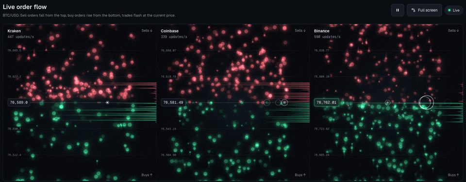
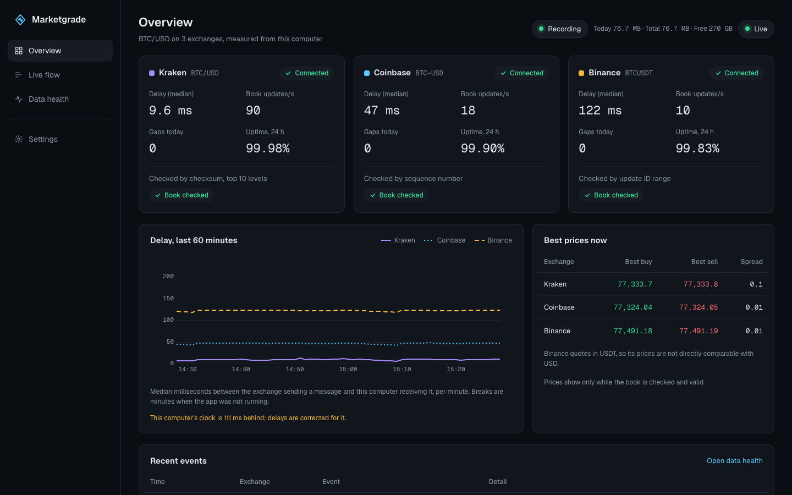
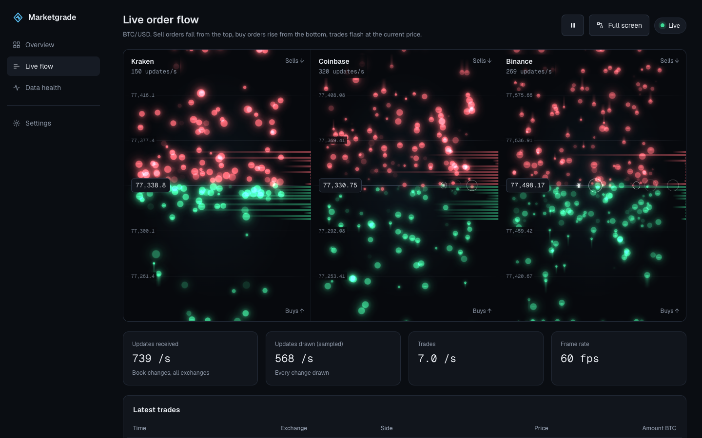
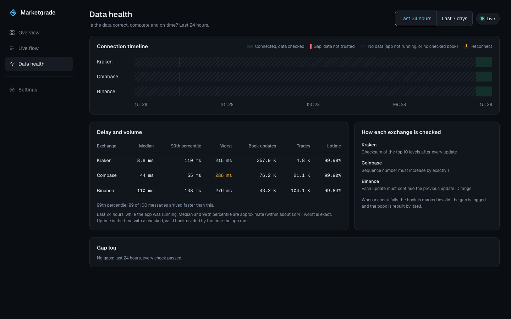

# Marketgrade

A free desktop app that measures, live on your own computer, how good the public market data of Kraken,
Coinbase and Binance is: how late it arrives, where it has gaps, and whether every update checks out.



| Overview | Live flow | Data health |
| -------- | --------- | ----------- |
| [](docs/images/overview.png) | [](docs/images/live-flow.png) | [](docs/images/data-health.png) |

## What it measures

Marketgrade connects to each exchange's public BTC/USD (Binance: BTC/USDT) order book and trades, keeps its own
copy of every book, and grades the data health per exchange:

- **Delay**: the time from the exchange's timestamp to the message arriving, measured against NTP time, so
  your computer's clock error does not count. Median, 99th percentile and worst, per minute and over the
  last 24 hours or 7 days.
- **Gaps**: every moment a book could not be trusted, why, and how long until it was repaired. Reconnects
  and uptime too.
- **Correctness**: every update is checked with the exchange's own method; a failed check marks the book
  invalid, logs a gap and rebuilds the book by itself.
  - **Kraken**: CRC32 checksum of the top 10 levels per side after every update.
  - **Coinbase**: each message's sequence number must be exactly one more than the last.
  - **Binance**: each update's ID range must continue where the previous one ended.

It also records every message to compressed hourly files (can be turned off in Settings), keeps per-minute
history for the charts, and draws the order flow live.

## Download

Get the latest version from the [Releases page](https://github.com/nazarma/marketgrade/releases/latest).

| Platform                                   | File                                   |
| ------------------------------------------ | -------------------------------------- |
| macOS 12 or later, Apple Silicon (M1 and later) | `Marketgrade_<version>_aarch64.dmg` |
| macOS 12 or later, Intel                   | `Marketgrade_<version>_x64.dmg`        |
| Windows 10 and 11, 64-bit                  | `Marketgrade_<version>_x64-setup.exe`  |
| Linux x86-64, any distribution with glibc 2.35 or later | `Marketgrade_<version>_amd64.AppImage` |
| Ubuntu 22.04, Debian 12 or later           | `Marketgrade_<version>_amd64.deb`      |

`SHA256SUMS.txt` on the same page lists every file's checksum.

## Opening an unsigned app

The installers are not code signed (that needs paid certificates from Apple and Microsoft), so your system
asks once before it runs Marketgrade.

**macOS 15 and later**

1. Open the DMG and drag Marketgrade to Applications.
2. Open Marketgrade from Applications. macOS says it could not verify that "Marketgrade" is free of malware.
   Click **Done** (not Move to Trash).
3. Open **System Settings**, then **Privacy & Security**, and scroll down to **Security**. Next to
   "Marketgrade" was blocked to protect your Mac, click **Open Anyway**. The button shows for about an hour
   after step 2.
4. Click **Open Anyway** in the dialog that follows and confirm with your password or Touch ID.

After that it opens normally. On macOS 12 to 14, Control-click the app in Applications, choose **Open**, then
**Open** again. Alternatively, in Terminal: `xattr -dr com.apple.quarantine /Applications/Marketgrade.app`.

**Windows**

Run the installer. When Microsoft Defender SmartScreen says "Windows protected your PC", click **More info**,
then **Run anyway**. Marketgrade installs for your user only, without administrator rights.

**Linux**

AppImage: make it executable, then run it. It needs FUSE 2, which Ubuntu 22.04 and later do not install by
default:

```sh
sudo apt install libfuse2   # Ubuntu and Debian, once
chmod +x Marketgrade_*_amd64.AppImage
./Marketgrade_*_amd64.AppImage
```

`.deb`: `sudo apt install ./Marketgrade_<version>_amd64.deb`, then start Marketgrade from your applications.

## Privacy

- No account, no sign-in, no telemetry, no update checks.
- Network connections go only to the exchanges' public market data endpoints and to time servers:
  - Kraken: `ws.kraken.com`, `api.kraken.com`
  - Coinbase: `advanced-trade-ws.coinbase.com`, `api.coinbase.com`
  - Binance: `data-stream.binance.vision`, `data-api.binance.vision`
  - Time: `time.apple.com`, `pool.ntp.org` (SNTP)
- The app's own server listens on `127.0.0.1` only and requires a secret generated at every start, so no
  other computer, and no other program on yours, can use it.
- All data stays in the data folder on your computer: settings, history and recordings (the recordings
  folder can be changed in Settings).

| System  | Data folder                                                 |
| ------- | ----------------------------------------------------------- |
| macOS   | `~/Library/Application Support/io.github.nazarma.marketgrade` |
| Windows | `%APPDATA%\io.github.nazarma.marketgrade`                   |
| Linux   | `~/.local/share/io.github.nazarma.marketgrade`              |

The backend also unpacks its database libraries once into `~/.net/marketgrade-backend` (macOS, Linux) or
`%TEMP%\.net\marketgrade-backend` (Windows). To remove everything, uninstall the app and delete these folders.

## Disclaimer

Marketgrade is an independent project, not affiliated with, endorsed by or sponsored by Kraken, Coinbase or
Binance; their names are used only to say whose data is measured. It uses their public market data for
personal, non-commercial use, subject to each exchange's terms. Nothing in it is financial advice. Binance may
be unavailable in some regions; Marketgrade then shows Binance as blocked and keeps measuring the others.

## Architecture in brief

- A Tauri 2 desktop shell (Rust) starts a self-contained .NET 10 backend and shows a React and TypeScript
  interface in the system's web view.
- The backend talks to the interface over a REST API and a SignalR hub on `127.0.0.1`, with a per-start token.
- One WebSocket connection per exchange; every message is stamped on arrival, recorded, and applied to that
  exchange's order book on a thread of its own.
- Each book is checked after every message with the exchange's own method and repaired by itself when a
  check fails.
- Delays are measured against NTP time kept by the monotonic clock, so clock steps and drift do not show up
  as delay.
- Recordings are zstd-compressed hourly files; per-minute history is in DuckDB and settings in SQLite.
- Live flow is drawn with PixiJS on WebGL from a sample the backend sends ten times a second.

More in [docs/architecture.md](docs/architecture.md).

**Measured**

| What | Result | How |
| ---- | ------ | --- |
| Memory allocated per message | **0 bytes** | BenchmarkDotNet's memory diagnoser over the hot path (receive, stamp, queue, classify, record, release) and each exchange's book worker. |
| Processing time per message | **2 to 11 µs** | Parse, apply and check: BenchmarkDotNet medians over 500 real recorded messages per exchange (Kraken 2.4, Coinbase 7.8, Binance 11.3 µs) on an Intel Core i7-9750H; runs vary by about a microsecond. Live medians in a 90-second run: 7 to 45 µs. |
| Recording compression | **6:1 to 11:1** | One recorded hour per exchange, zstd level 3, bytes on disk before and after (Binance 6.1, Kraken 7.7, Coinbase 11.0). |

## Building from source

Prerequisites:

- [.NET SDK 10](https://dotnet.microsoft.com/download)
- [Node.js 24 LTS](https://nodejs.org/) (see `.nvmrc`)
- [pnpm 12](https://pnpm.io/installation), for example `npm install -g pnpm@12`
- [Rust](https://rustup.rs/) (stable)
- The [Tauri system dependencies](https://v2.tauri.app/start/prerequisites/) for your platform

Run in development:

```sh
pnpm install
pnpm dev
```

Build an installer for this computer:

```sh
pnpm publish:backend
pnpm tauri build --config src/desktop/tauri.release.conf.json
```

The installers are in `src/desktop/target/release/bundle/`. On macOS, set `CI=true` if building the DMG
times out waiting for Finder. Tests, checks, diagnostics and the repository layout are in
[docs/development.md](docs/development.md); releases in [docs/releasing.md](docs/releasing.md).

## Licence

[MIT](LICENSE). Third-party software and its licences: [THIRD-PARTY-NOTICES.md](THIRD-PARTY-NOTICES.md).
